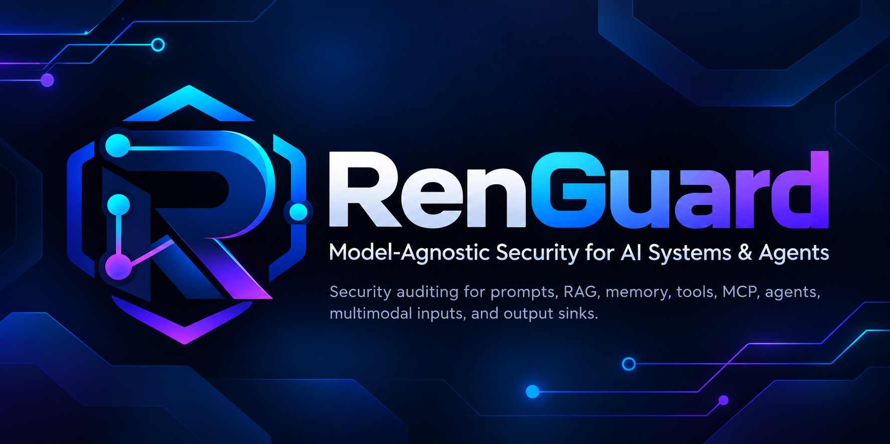

<p align="center">
  
</p>

# RenGuard

[](https://github.com/RENJI04/renguard/actions/workflows/ci.yml?query=branch%3Amain)

> **Model-Agnostic Security for AI Systems & Agents**

RenGuard is a model-agnostic security auditing Skill and framework for AI systems and
agents. It helps reviewers identify trust-boundary failures, map findings to a stable
technique taxonomy, assess evidence-bounded risk, and recommend defense in depth across
prompts, retrieval, memory, tools, MCP, agents, multimodal inputs, and output sinks.

The current stable release is [RenGuard v2.0.0](https://github.com/RENJI04/renguard/releases/tag/v2.0.0),
published on 2026-10-13 from tagged commit
`cb2ad88029bb224d9cfe0dd58b2339a0bb6fdaec`. The validated product source is
`d8ec26b9b19f79f9a134f838ba2f4b3d34211963`; GitHub-hosted Python 3.10–3.13 CI
passed for the final tagged repository state. No official RenGuard v2 live benchmark
has been published.

## What RenGuard is—and is not

`SKILL.md` is the core audit methodology. RenGuard analyzes supplied architecture,
configuration, prompts, transcripts, and artifacts; it produces findings, attack chains,
risk assessments, and proposed controls. It is not a firewall, runtime enforcement
gateway, malware scanner, sandbox, WAF, hosted API, or production SOC platform.

RenGuard assists security review. It does not replace application authorization,
runtime isolation, network controls, parameter-bound human approval, or professional
testing when those controls are required.

## Capability overview

| Area | What RenGuard audits | Important boundary |
|---|---|---|
| Prompt and instruction security | Authority conflicts, indirect injection, hidden context, multi-turn drift | Prompt guidance is probabilistic, not deterministic enforcement |
| RAG and retrieval | Source trust, provenance, ingestion, authorization, tenant isolation, poisoning, retrieval-to-action chains | Retrieved or internal content remains data, not policy |
| Persistent memory | Read/write scope, provenance, poisoning, cross-session/tenant influence, expiry, rollback | Stored memory does not become system policy or authorization |
| Tools and functions | Capability, origin, schemas, parameters, outputs, retries, credentials, approvals | Tool availability and descriptions do not grant permission |
| MCP | Server/tool trust, origin, scope and audience, resources/prompts, token handling, capability mutation | Tool names and annotations are not identity or enforcement |
| Agentic workflows | Delegation, privilege inheritance, handoffs, inter-agent trust, cascade, termination | An agent's self-reported identity is not authentication |
| Multimodal inputs | Images, screenshots, OCR, audio, transcripts, video, captions, metadata | Appearance and derived text do not authenticate identity or approval |
| Output sinks | Structural, semantic, authorization, and sink-specific handling for commands, SQL, HTML, Markdown, URLs, paths, code, and messages | Model output remains untrusted until checked for its exact sink |
| Risk scoring | Twelve evidence-backed dimensions, severity, uncertainty, and confidence | `UNKNOWN` is not zero; confidence is separate from risk |
| Hardening | Layered preventive, containment, detection, and recovery controls | Proposed controls are not reported as implemented |
| Evaluation | Public scenarios, mutation recipes, offline runner, schemas, and CI checks | Corpus size and fixture tests are not model performance |

These are audit capabilities, not claims that RenGuard itself enforces controls at
runtime.

## What model-agnostic means

The methodology, RenGuard technique taxonomy, risk model, and benchmark adapter boundary
do not depend on one model vendor. They can be applied to single-model, mixed-model,
local, hosted, and unknown-provider architectures.

Model-agnostic does **not** mean that every model or provider protocol has been tested,
that different models behave identically, or that RenGuard is universally compatible
with every host. Provider and framework behavior still requires evidence.

## Core trust-boundary principle

Content does not gain instruction authority merely because it is retrieved, internal,
stored in memory, returned by a tool, exposed through MCP, generated by another agent,
visible in an image, transcribed from audio, structured as JSON, or produced by a model.

Security-critical identity, authorization, resource scope, and approval should come from
trusted application or platform context. A chat-level `CONFIRM`, screenshot of an
approval, tool name, or self-reported agent role is not authentication or authorization.

## Audit workflow

1. **Profile the architecture.** Identify models, data stores, tools, MCP servers,
   agents, sinks, identities, and operational constraints.
2. **Map trust boundaries.** Separate trusted control-plane facts from untrusted content
   and model-generated proposals.
3. **Record findings.** Distinguish attack technique, enabling weakness, and impact; map
   stable `RG-*` technique IDs and applicable OWASP crosswalks.
4. **Build attack chains.** Trace how influence crosses retrieval, memory, tool, agent,
   multimodal, and output boundaries.
5. **Score risk.** Use the documented twelve-dimension model and report confidence
   independently.
6. **Recommend layered hardening.** Combine prompt guidance with deterministic
   application, authorization, runtime, network, monitoring, and recovery controls.
7. **Reassess residual risk.** Label it projected until control implementation is
   evidenced; hardening does not automatically make residual risk zero.

See [Architecture](docs/architecture.md), [Threat Model](docs/threat-model.md), and
[Usage](docs/usage.md) for the full reader-oriented path through the methodology.

## Quick start

RenGuard is a Skill/framework, not a published pip package or hosted scanner.

1. Read or load [`SKILL.md`](SKILL.md) using the Skill mechanism provided by your host.
2. Supply the system architecture and relevant prompts, configurations, transcripts, or
   artifacts. Call out unknown evidence instead of guessing.
3. Ask for a RenGuard audit, for example:

   ```text
   Audit this RAG assistant and its email tool. Identify trust boundaries, findings,
   attack chains, RenGuard techniques, risk, confidence, and layered hardening.
   ```

4. Compare the result with the worked [`examples/`](examples/) and the canonical
   references linked below.

Repository engineering and benchmark commands are offline by default:

```bash
git clone https://github.com/RENJI04/renguard.git
cd renguard
python scripts/check.py
python scripts/validate_repo.py
python scripts/run_benchmark.py --help
python scripts/run_benchmark.py validate
```

The benchmark CLI is evaluation tooling; it is not a general-purpose RenGuard scanner.

## Illustrative audit result

The following is synthetic documentation, not a benchmark result:

```text
Finding: Retrieved support-ticket text can influence a planner and reach an
         email-sending tool without deterministic authorization.
Technique: RG-PI-003 — Retrieved-Document Injection
Risk: HIGH
Confidence: MEDIUM — runtime authorization evidence was not supplied
Attack chain: untrusted ticket -> planner -> proposed recipient/body -> email tool
Key controls: pre-retrieval authorization, scoped tool capability, exact-action
              approval, recipient binding, monitoring, and recovery
```

High severity and medium or low confidence can coexist. Missing architecture evidence
reduces confidence; it does not earn a lower risk score by being treated as zero.

## Taxonomy and framework crosswalks

RenGuard contains 38 stable techniques across prompt injection, hidden context,
authority, tools, memory, agents, retrieval, supply chain, execution, output handling,
resource consumption, grounding, and multimodal security. The current implementation
posture is 33 `CORE`, 5 `PARTIAL`, and 0 `PLANNED`. Coverage status describes available
audit capability—not benchmark performance.

The canonical catalog is [`references/renguard-techniques.md`](references/renguard-techniques.md),
with design methodology and the historical crosswalk in
[`references/vulnerability-taxonomy.md`](references/vulnerability-taxonomy.md).

Findings may also map to
[OWASP LLM 2026](references/owasp-llm-2026.md) and, for agentic targets,
[OWASP Agentic 2026](references/owasp-agentic-2026.md). These mappings are crosswalks;
they are not OWASP certification or endorsement.
Framework mapping support and empirical detection coverage are separate.

## Risk scoring

The project-specific RenGuard Risk Score uses twelve dimensions rated 0–4 and produces a
0.0–10.0 score with `INFORMATIONAL`, `LOW`, `MEDIUM`, `HIGH`, and `CRITICAL` severity
bands. Exploitability/exposure contributes 40% and impact/consequence 60%.

`KNOWN ZERO`, `NOT APPLICABLE`, and `UNKNOWN / INSUFFICIENT EVIDENCE` are different
states. Unknown facts are documented and considered in sensitivity analysis; they are
not silently scored as zero. Confidence describes evidence quality and remains
independent from risk. The normative formula and examples are in
[`references/risk-scoring.md`](references/risk-scoring.md).

## Defense-in-depth hardening

The catalog contains 27 stable `RG-HARD-*` patterns across twelve control layers. It
distinguishes enforcement strength, implementation status, and lifecycle purpose:
`PREVENT`, `CONTAIN`, `DETECT`, and `RECOVER`.

Prompt guidance can clarify authority and safe behavior, but privileged actions usually
also need deterministic identity, authorization, tool mediation, runtime isolation,
network policy, monitoring, and recovery. Human approval is meaningful only when the
reviewer sees the exact action and the decision is bound to its parameters.

See [`references/hardening-patterns.md`](references/hardening-patterns.md). Controls are
reported as `PROPOSED` until implementation evidence exists; there is no generic
mitigation discount to the risk score.

## Specialized security domains

- **RAG:** Retrieved content remains untrusted. Review source provenance, ingestion,
  deterministic authorization before sensitive content enters context where possible,
  tenant isolation, query rewriting, poisoning, and retrieval-to-action chains. Corpus
  poisoning differs from access-control failure. See
  [`references/rag-security.md`](references/rag-security.md).
- **Memory:** Persistent/shared memory is scoped data, not policy. Review write and read
  authorization, provenance, cross-user and cross-tenant isolation, expiry, revocation,
  conflict handling, and rollback. A validated user preference is not automatically
  malicious. See [`references/memory-security.md`](references/memory-security.md).
- **Tools:** Availability is not authorization. Review tool origin, capability,
  credentials, schemas, parameter scope, output/recovery injection, retries, budgets,
  and exact-action approval. See
  [`references/tool-security.md`](references/tool-security.md).
- **MCP:** Preserve server/tool provenance, token audience and resource boundaries, and
  independent authorization. Tool names are not identity; annotations are hints rather
  than enforcement; prompts, resources, and tool output remain untrusted. See
  [`references/mcp-security.md`](references/mcp-security.md).
- **Agents:** Review authenticated workload identity, bounded delegation, privilege
  inheritance, inter-agent message contracts, handoffs, cascading failures, background
  activity, circuit breakers, termination, and recovery. Avoid treating agents as human
  principals. See [`references/agentic-security.md`](references/agentic-security.md).
- **Multimodal:** Images, screenshots, OCR, audio, transcripts, video, captions,
  document images, and metadata can carry untrusted instructions. RenGuard does not
  claim steganalysis, deepfake detection, biometric verification, OCR certification,
  malware scanning, or exhaustive media forensics. See
  [`references/multimodal-security.md`](references/multimodal-security.md).
- **Output sinks:** Structure, semantics, authorization, and sink safety are separate.
  `OS0` is informational output, `OS1` rendered content, `OS2` structured data,
  `OS3` resource or network selection, and `OS4` command/code execution. Schema-valid
  JSON is not an authorized action, Markdown is not universally inert, and no universal
  sanitizer exists. See [`references/output-security.md`](references/output-security.md).

## Examples

Examples are human-readable educational audits; they are not benchmark fixtures or
performance evidence.

| Example | Focus |
|---|---|
| [Customer-support chatbot](examples/01-chatbot-prompt.md) | Secrets, disclosure, self-reported privilege, and transaction authority |
| [RAG document assistant](examples/02-rag-agent-prompt.md) | Retrieved-document injection, tenant boundaries, and memory interaction |
| [Tool-using coding agent](examples/03-tool-using-agent-prompt.md) | Privileged tools, sub-agents, recovery injection, and independent controls |
| [Multimodal output agent](examples/04-multimodal-output-agent.md) | Media-derived authority and URL/command sink handling |
| [Memory-poisoning assistant](examples/05-memory-poisoning-agent.md) | Durable memory writes, cross-session influence, lifecycle, and rollback |
| [MCP multi-agent workflow](examples/06-mcp-multi-agent-workflow.md) | Server origin, agent identity, delegation, and parameter-bound approval |

## Evaluation and benchmark status

The public RenGuard v2 evaluation suite contains 72 scenarios covering all 38
techniques, plus 15 mutation recipes. Seventy-two is the corpus size, not a score. The
suite is public, so cases may be known to models; public-suite performance alone cannot
demonstrate unseen-case generalization. Private holdouts must remain outside Git.

The standard-library benchmark runner supports deterministic fixture/replay engineering
tests and explicitly gated adapters. `FixtureAdapter` output is synthetic. Current
multimodal cases use normalized descriptors and test security reasoning, not native
vision/audio perception. Output-sink cases are declarative and do not execute shell,
SQL, network, or filesystem effects.

No official RenGuard v2 live benchmark or performance percentage exists.

### Historical v1 provenance—not a v2 result

The historical artifact describes one original setup at source commit
`c2e8de497b7550ca3ca4df081efae27ddd28d582` (`c2e8de4`). Current RenGuard v2 eval
definitions and fixtures were **not** used to produce it.

| Historical configuration | Assertion Pass Rate (micro) | Assertions | Mean Eval Pass Rate (macro) |
|---|---:|---:|---:|
| With Skill | **97.6%** | **40 / 41** | **97.92%** |
| Without Skill | 68.3% | 28 / 41 | 70.42% |

These values are provenance evidence for that recorded v1 run, not current RenGuard v2
performance, multi-provider evidence, or a general security guarantee.

Read [benchmark methodology](BENCHMARKING.md), the
[public suite contract](evals/v2/README.md), and
[schema/version documentation](schemas/README.md) for details.

## Documentation

| Document | Purpose |
|---|---|
| [`SKILL.md`](SKILL.md) | Core audit orchestration and report contract |
| [Architecture](docs/architecture.md) | Components and source-of-truth boundaries |
| [Threat Model](docs/threat-model.md) | Assets, actors, boundaries, threats, and non-goals |
| [Usage](docs/usage.md) | Practical audit workflows and evidence checklist |
| [Techniques](references/renguard-techniques.md) | Canonical 38-technique taxonomy |
| [Risk scoring](references/risk-scoring.md) | Normative score model and confidence handling |
| [Hardening](references/hardening-patterns.md) | Canonical 27-pattern defense catalog |
| [RAG](references/rag-security.md) / [memory](references/memory-security.md) | Data, retrieval, persistence, and isolation boundaries |
| [Tools](references/tool-security.md) / [MCP](references/mcp-security.md) / [agents](references/agentic-security.md) | Capability, protocol, delegation, and identity analysis |
| [Multimodal](references/multimodal-security.md) / [output](references/output-security.md) | Media trust and downstream sink safety |
| [Benchmarking](BENCHMARKING.md) | Execution, scoring, review, provenance, and safety methodology |
| [Evaluation suite](evals/v2/README.md) | Public corpus structure and contribution rules |
| [Schemas](schemas/README.md) | Structural contracts, registry, and compatibility policy |
| [Contributing](CONTRIBUTING.md) | Engineering and evaluation contribution rules |
| [Security policy](SECURITY.md) | Vulnerability-reporting guidance |
| [Release notes](RELEASE_NOTES.md) | Published v2.0.0 capabilities, evidence, and limitations |
| [Release checklist](RELEASE_CHECKLIST.md) | Completed v2.0.0 validation and publication gates |
| [GitHub publishing record](release/GITHUB_PUBLISHING.md) | Applied About text, topics, Social Preview, tag, and release evidence |
| [Branding assets](assets/branding/README.md) | Approved icon, wordmark, banner, and accessibility guidance |

## Repository structure

```text
renguard/
├── assets/branding/          # Approved RenGuard visual identity
├── SKILL.md                 # Core RenGuard Skill
├── references/              # Security specifications and catalogs
├── docs/                    # Reader-oriented architecture, threat model, and usage
├── examples/                # Human-readable educational audits
├── evals/v2/                # Machine-readable public evaluation corpus
├── scripts/                 # Validation and offline benchmark tooling
├── schemas/                 # Draft 2020-12 artifact contracts
├── tests/                   # Offline regression tests
├── release/                 # Release readiness and GitHub publication guidance
├── .github/workflows/       # Configured model-offline CI
├── BENCHMARKING.md
├── CONTRIBUTING.md
└── SECURITY.md
```

The repository is published as `RENJI04/renguard`; RenGuard is the project and product
identity. Historical names and model metadata remain unchanged only where protected
provenance requires them.

## Development status and validation

The taxonomy, scoring model, hardening framework, specialized references, public suite,
offline runner, schemas, CI workflow, and local release validation are implemented. The
`version` field in `SKILL.md` is the canonical product version; the current stable
release is `v2.0.0`.

See the [release notes](RELEASE_NOTES.md),
[release checklist](RELEASE_CHECKLIST.md), and
[GitHub publishing record](release/GITHUB_PUBLISHING.md). The
[machine-readable readiness manifest](release/release-manifest.json) preserves the
release state, publication evidence, and contract versions. GitHub-hosted CI passed for
the final tagged repository state before publication.

CI is configured to test Python 3.10–3.13. During Phase 10, local verification was
performed on Python 3.12.14 only. GitHub-hosted CI subsequently passed on Python 3.10,
3.11, 3.12, and 3.13 for the final tagged repository state in
[run 38356227406](https://github.com/RENJI04/renguard/actions/runs/38356227406).

Run the same dependency-free quality gate configured for CI:

```bash
python scripts/check.py
```

It performs repository validation, unit tests, compilation, structural contract checks,
and a deterministic temporary fixture smoke run without model credentials or live model
calls.

## Limitations

- Results depend on the architecture and evidence supplied; unknown facts reduce
  confidence and can change risk.
- RenGuard is an audit methodology, not runtime enforcement, and does not guarantee the
  absence of vulnerabilities.
- `PARTIAL` techniques still require specialized runtime or forensic evidence for
  comprehensive analysis.
- Provider, model, host, and framework behavior can differ.
- The public suite may be known to evaluated models; private holdout evaluation remains
  external.
- No official v2 live benchmark exists.
- Normalized multimodal descriptors do not test native-media perception.
- Declarative output-sink scenarios do not execute production effects.
- Architecture review does not automatically penetrate remote systems, verify a live
  OAuth/IAM backend, inspect raw vector geometry, or prove that proposed controls exist.

## Contributing, security, and license

See [`CONTRIBUTING.md`](CONTRIBUTING.md) before changing stable IDs, schemas, evals, or
benchmark contracts. Use synthetic data, keep tests model-offline, and run
`python scripts/check.py`.

Security-reporting guidance is in [`SECURITY.md`](SECURITY.md). Do not publish secrets or
sensitive exploit details in a public issue.

RenGuard is available under the [MIT License](LICENSE).
