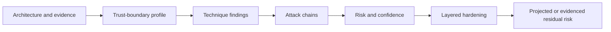

# RenGuard Architecture

RenGuard is a security auditing Skill and framework. It interprets supplied system
evidence and produces an audit; it is not deployed inline as a runtime security gateway.
This document explains how the repository's parts fit together without redefining their
normative contracts.

## Audit architecture



The input is documentation, configuration, prompts, transcripts, or other supplied
evidence. RenGuard does not infer that an undocumented control exists. Missing facts are
reported as `UNKNOWN / INSUFFICIENT EVIDENCE`, not converted to zero.

## Repository components

| Component | Role | Source-of-truth boundary |
|---|---|---|
| [`SKILL.md`](../SKILL.md) | Audit orchestration, workflow, and report contract | Core product behavior |
| [`references/renguard-techniques.md`](../references/renguard-techniques.md) | Stable `RG-*` attack-technique taxonomy | Technique identity, meaning, and coverage posture |
| [`references/risk-scoring.md`](../references/risk-scoring.md) | Twelve-dimension risk model | Formula, weights, severity, evidence states, and confidence |
| [`references/hardening-patterns.md`](../references/hardening-patterns.md) | Twenty-seven defense-in-depth patterns | Control layer, strength, status, and lifecycle meaning |
| Specialized references | Conditional RAG, memory, tool, MCP, agentic, multimodal, and output analysis | Domain-specific audit rules; loaded only when architecture warrants |
| [`examples/`](../examples/) | Human-readable worked audits | Educational material, not benchmark ground truth |
| [`evals/v2/`](../evals/v2/) | Public machine-readable scenarios and mutations | Evaluation definitions, never Skill instructions |
| [`scripts/run_benchmark.py`](../scripts/run_benchmark.py) | Offline-first adapter-based runner | Execution, capture, scoring, review, and comparison workflow |
| [`schemas/`](../schemas/) | Draft 2020-12 structural contracts | Artifact interoperability, not semantic security correctness |
| [`scripts/validate_repo.py`](../scripts/validate_repo.py) | Cross-file semantic and provenance checks | Repository invariants and protected-history checks |
| [`scripts/check.py`](../scripts/check.py) | Shared developer/CI quality gate | Offline validation, tests, compilation, schemas, and fixture smoke |

## Conditional analysis routing

`SKILL.md` routes to specialized references only when the target architecture provides
the relevant evidence:

```text
SKILL.md
├── RAG / retrieval       -> references/rag-security.md
├── persistent memory     -> references/memory-security.md
├── tools / functions     -> references/tool-security.md
├── MCP                   -> references/mcp-security.md
├── agents / delegation   -> references/agentic-security.md
├── multimodal inputs     -> references/multimodal-security.md
└── downstream sinks      -> references/output-security.md
```

This prevents absent subsystems from being invented while still allowing cross-domain
chains when several boundaries are evidenced.

## Trust and control planes

RenGuard separates untrusted content from trusted control-plane facts. Retrieved text,
memory, tool output, MCP resources, peer-agent messages, media-derived text, and model
output remain data. Authenticated identity, authorization decisions, resource scope,
capability grants, and approval should be supplied and enforced outside those channels.

Prompt controls can influence model behavior, but deterministic application, runtime,
network, and independent approval controls provide stronger boundaries. Monitoring is a
detection control, not prevention. Recovery limits harm after a failure; it does not
erase the original risk.

## Evaluation architecture

The public suite contains 72 scenarios and 15 mutation recipes. The runner creates
versioned artifacts through fixture, replay, or explicitly gated command adapters.
Structural schemas validate storage shape; the repository validator checks semantics and
provenance; tests provide regression evidence. Passing any one layer does not establish
security or model performance.

No official RenGuard v2 live benchmark exists. See
[`BENCHMARKING.md`](../BENCHMARKING.md) for the execution and scoring methodology.

## Engineering boundary

Standard validation is dependency-free and model-offline. CI is configured for a Python
3.10–3.13 target matrix, but Phase 10 local verification covered Python 3.12.14 only and
no GitHub-hosted matrix PASS is claimed. The repository contains no provider SDK,
credential setup, release automation, or documentation-site framework.
